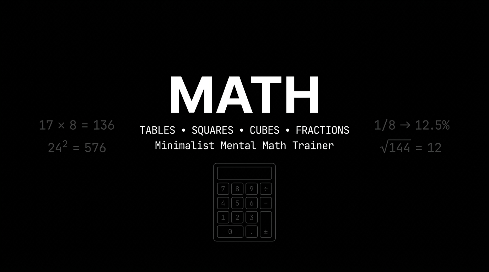

# MATH

<p align="center">
  
</p>

> Minimalist, mobile-first mental math trainer for multiplication tables, squares, cubes, and fraction-to-percentage conversions.

[](LICENSE)
[](index.html)
[](https://tailwindcss.com/)
[](package.json)
[](https://parvshah2001.github.io/Math/)

---

## Overview

Speed and confidence in quantitative reasoning—whether for competitive exams (CAT, GMAT, GRE, banking), technical interviews, or everyday problem-solving—rely heavily on rapid, automated recall of foundational arithmetic.

Most online math trainers suffer from cluttered interfaces, distracting gamification, intrusive advertisements, or awkward mobile keyboard popups that induce viewport shifts and scrolling.

**MATH** is a distraction-free, zero-dependency, pure black-and-white web application engineered for high-throughput active recall drills. The application enforces a strict zero-scroll viewport lock, offers native tactile haptic feedback on mobile devices, and supports seamless dual-input via an on-screen keypad and physical desktop keyboard shortcuts.

---

## Demo & Previews

### Interface Wireframe

```
┌────────────────────────────────────────────────────────┐
│ MATH                                    REFERENCE BOOK │
├────────────────────────────────────────────────────────┤
│                                                        │
│  SOLVED: 18         STREAK: 18              ACC: 100%  │
│                                                        │
│  ┌──────────────────────────────────────────────────┐  │
│  │                    TABLE OF 17                   │  │
│  │                                                  │  │
│  │                     17 × 8                       │  │
│  │                                                  │  │
│  │                   [  136_  ]                     │  │
│  │                     [hint]                       │  │
│  └──────────────────────────────────────────────────┘  │
│                                                        │
│       ┌─────────┬─────────┬─────────┐                  │
│       │    1    │    2    │    3    │                  │
│       ├─────────┼─────────┼─────────┤                  │
│       │    4    │    5    │    6    │                  │
│       ├─────────┼─────────┼─────────┤                  │
│       │    7    │    8    │    9    │                  │
│       ├─────────┼─────────┼─────────┤                  │
│       │    .    │    0    │   DEL   │                  │
│       └─────────┴─────────┴─────────┘                  │
│       ┌─────────────────────────────┐                  │
│       │            ENTER            │                  │
│       └─────────────────────────────┘                  │
└────────────────────────────────────────────────────────┘
```

> **Visual Screenshots Placeholder**:
> *Practice Lobby View (`docs/screenshots/lobby.png`), Active Recall Drill (`docs/screenshots/gameplay.png`), and Reference Book Modal (`docs/screenshots/reference.png`) can be captured and placed in `docs/screenshots/`.*

---

## Key Features

- **Strict Zero-Scroll Viewport Lock**: The entire practice interface is fixed to `100dvh` (Dynamic Viewport Height). No layout shifts, accidental page scrolls, or double-tap zooming occur during high-speed typing.
- **4 Workout Modes**:
  - **Endless**: Continuous practice with zero time pressure.
  - **60s Blitz**: Real-time 60-second countdown benchmark testing active recall under time pressure.
  - **50 Qs Attack**: Precision sprint measuring the exact time required to clear 50 problems.
  - **Speed Gate (Sudden Death)**: Answer each problem within an adaptive, dynamic time window (2.2s down to 1.3s). One timeout or miscalculation ends the streak instantly.
- **Problem Difficulty Weighting**: Problems with slower response times (e.g., $12 \times 8$ taking >2.5s) or past errors reappear significantly more frequently via weighted roulette sampling than automatic calculations like $2 \times 5$.
- **Local-First Analytics & Multiplication Heatmap**:
  - **Daily Goal & Streak Tracking**: Real-time daily solved counter (goal: 50) and consecutive day streak tracker.
  - **12 × 10 Matrix Heatmap**: Visual grid showing exact average latency per table combination (1–12), highlighting slow bottlenecks (>2.5s) in white.
  - **Weak-Spot Diagnostics**: Instant ranking of slowest latency bottlenecks.
  - **Full Data Portability**: Export, import, and reset training records as standard JSON files directly in the browser with zero cloud tracking.
- **Smart Spaced Repetition**: Missed questions automatically requeue 3–5 items later, and persist into a cumulative "Drill Mistakes" weak-spot engine.
- **Curated High-Value Disciplines**:
  - Multiplication Tables (1–12, with 11 and 12 integrated)
  - Squares (1–20)
  - Cubes (1–12)
  - Fractions & %: Bidirectional active recall covering all unit fractions from 1/2 to 1/20 plus common multiples (both Fraction to % and Percentage to Fraction in the same discipline)
  - 2-Digit Addition
  - Mixed Training & Drill Mistakes
- **Bidirectional Fraction Engine**: Includes full 1/2 through 1/20 unit fraction conversions and common multiples. Drills both directions (e.g., `1/8 to %` and `12.5% to fraction`) with on-screen `/` key support and flexible input tolerance for percentages.
- **Instant Advance Mode**: An optional toggle that immediately advances to the next question the moment the correct answer is entered, saving an extra tap per problem.
- **Tactile Haptic Feedback**: Vibrates lightly (`navigator.vibrate`) upon keypress on supported mobile devices to emulate physical calculator keys.
- **Dual Input Architecture**: Symmetrical virtual 13-key numpad for mobile thumbs (featuring dedicated `.` and `/` keys), alongside full physical keyboard keybindings (`0`–`9`, `.`, `/`, `Backspace`, `Enter`, `Escape`, `H`).
- **Built-in Reference Book**: An overlay study handbook displaying all multiplication tables up to 12, squares to 20, cubes to 12, and complete unit fractions (1/2 to 1/20) & common percentage rules.
- **Zero Runtime Dependencies**: Written entirely in vanilla HTML5, CSS3, and ES6+ JavaScript. Operates 100% offline.

---

## Tech Stack

| Layer | Technology | Details |
| :--- | :--- | :--- |
| **Markup** | HTML5 | Semantic structure with progressive web app (PWA) meta tags |
| **Styling** | Tailwind CSS (CDN) + Custom CSS | High-contrast OLED monochrome palette (`#000000`, `#ffffff`) |
| **Logic** | Vanilla JavaScript (ES6+) | Standalone `GameEngine` class, zero external framework overhead |
| **Hardware Integration** | Web Vibration API | Tactile feedback for mobile tap events via `navigator.vibrate` |
| **Distribution** | Static Web Application | Compatible with GitHub Pages, Cloudflare Pages, Vercel, Netlify |

---

## Project Structure

```text
.
├── .gitignore               # Ignored build artifacts, OS files, and editor configs
├── index.html               # Complete single-page application (UI, CSS, GameEngine)
├── LICENSE                  # MIT License
├── package.json             # Lightweight metadata and local development scripts
├── README.md                # Project documentation and developer guide
└── docs/
    ├── ARCHITECTURE.md      # Technical breakdown of state, inputs, and viewport rules
    └── DEPLOYMENT.md        # Step-by-step deployment guide for multiple platforms
```

---

## Getting Started

### Prerequisites

- Any modern web browser (Google Chrome, Apple Safari, Mozilla Firefox, Microsoft Edge).
- *Optional*: Node.js (v18+) or Python 3 to run a local development server.

### Option 1: Direct File Execution (Zero Install)

Simply double-click `index.html` or open it directly in your browser:
```bash
# Windows
start index.html

# macOS
open index.html

# Linux
xdg-open index.html
```

### Option 2: Local HTTP Server with Node.js

Clone the repository and run the local development server:
```bash
# 1. Clone repository
git clone https://github.com/ParvShah2001/Math.git
cd Math

# 2. Start local server on http://localhost:3000
npm start
```

### Option 3: Local HTTP Server with Python 3

```bash
python -m http.server 3000
```
Then visit `http://localhost:3000` in your browser.

---

## Usage Examples

### 1. Multiplication Drill
- **Prompt**: `17 × 8`
- **Keypad / Keyboard Input**: `1` $\rightarrow$ `3` $\rightarrow$ `6`
- **Result**: Immediate visual flash feedback. With **Instant Advance** enabled, the app automatically transitions to the next problem without pressing `Enter`.

### 2. Fraction & Percentage Drills (Bidirectional)
- **Forward Prompt**: `1/8 to %`
  - **Input**: `1` -> `2` -> `.` -> `5`
  - **Tolerance**: Accepted as `12.5` or `12.5%`. With Instant Advance enabled, auto-submits on entry.
- **Reverse Prompt**: `12.5% to fraction`
  - **Input**: `1` -> `/` -> `8`
  - **Tolerance**: Accepted as `1/8`. Auto-submits instantly upon tapping `8`.

### 3. Physical Keyboard Shortcuts

| Key | Action |
| :--- | :--- |
| `0`–`9`, `.`, and `/` | Type numeric values, decimal points, or fraction slashes |
| `Backspace` | Delete last entered character |
| `Enter` or `Space` | Submit answer (when Instant Advance is off) / Start session / Retry |
| `Escape` | Abort active session and view Debrief summary |
| `H` | Toggle mental math trick / mnemonic hint |

---

## Roadmap

- [x] **Configurable Workout Modes**: 60s Blitz, 50 Qs Attack, and adaptive Speed Gate (Sudden Death).
- [x] **Problem Difficulty Weighting**: Latency-aware spaced repetition prioritizing slow calculations.
- [x] **Local-First Analytics & Heatmap**: Daily streak tracker, 12×10 multiplication heatmap, bottleneck diagnostics, and JSON backup.
- [ ] **Full PWA Manifest & Service Worker**: Enable installability as an offline home-screen standalone app.
- [ ] **Custom Range Builder**: Allow users to specify custom factor bounds (e.g., drilling specifically the 11 and 12 tables).

---

## Contributing

Contributions, feedback, and feature suggestions are welcome.

1. **Fork the repository**: Click the **Fork** button at the top right of this page.
2. **Create a branch**:
   ```bash
   git checkout -b feature/your-feature-name
   ```
3. **Commit your changes**:
   ```bash
   git commit -m "Add custom factor range selector"
   ```
4. **Push to your branch**:
   ```bash
   git push origin feature/your-feature-name
   ```
5. **Open a Pull Request**: Detail the rationale and verify that the zero-scroll layout remains functional on mobile viewport sizes.

---

## License

This project is open-source software licensed under the [MIT License](LICENSE).

---

## Author

**Parv Shah**
- **GitHub**: [@ParvShah2001](https://github.com/ParvShah2001)
- **Repository**: [https://github.com/ParvShah2001/Math](https://github.com/ParvShah2001/Math)
- **Email**: [parvshah240@gmail.com](mailto:parvshah240@gmail.com)
